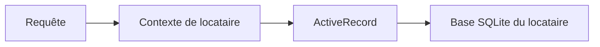

# basecamp/activerecord-tenanted

> Gem Rails pour héberger plusieurs locataires isolés dans une même application.

## Le problème
Isoler les données de chaque client dans une application Rails partagée demande de la plomberie dans tout le code.

## Ce que ça fait vraiment
Persiste les données de chaque locataire dans un stockage séparé et exécute le code dans un contexte de locataire isolé. Vise une écriture identique à une application mono-locataire. Seul l'adaptateur sqlite3 est pleinement pris en charge.

## Comment c'est branché
Schéma simplifié d'après la fiche, sans diagramme fourni.


## Essayer
```bash
bundle add activerecord-tenanted
```

## Coût et pièges
Gratuit. Rails et Ruby requis. Seul sqlite3 est géré pour l'instant, les autres bases sont à discuter avec les mainteneurs.

## Ce que ce n'est pas
Ce n'est pas une solution multi-bases complète. La configuration détaillée est dans GUIDE.md, absent de la fiche.

## Alternatives
Aucune alternative nommée dans le README.

## Pour toi
À ignorer : pertinent seulement pour une application Rails multi-clients, hors du périmètre data / IA / MLOps.

