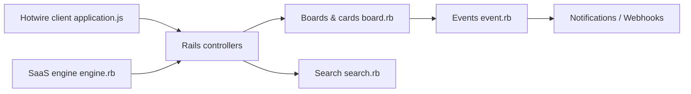

# basecamp/fizzy

> Source code of Fizzy, 37signals' kanban tool for tracking tickets and ideas.

## The problem
Track tickets and ideas on a kanban board, without depending on a hosted service.

## What it actually does
A Ruby on Rails monolith with Hotwire (Turbo, Stimulus), multi-tenant: boards, columns, cards, comments, labels, notifications (in-app, mail, web push), webhooks, search, magic-link sign-in and passkeys. A separate "SaaS" engine adds billing and storage limits.

## How it is wired


## Trying it
```bash
curl https://get.once.com/fizzy | sh
```
Docker and Kamal deployments are described in separate guides.

## Cost and gotchas
Free when self-hosted. The license is present but not identified by GitHub: read it before any commercial use. The install script is executed remotely.

## What it is not
Not a project management tool for data science. The SaaS layer is not meant for simple self-hosting.

## Alternatives
- ONCE: installation and update tool recommended by the README.

## For you
Ignore: generic tracking tool, unrelated to your data/AI stack; license to be clarified.
