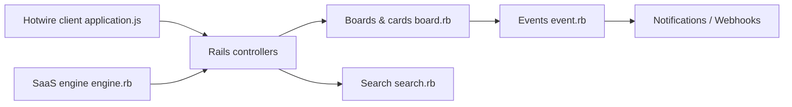

# basecamp/fizzy

> Code source de Fizzy, l'outil kanban de 37signals pour suivre tickets et idées.

## Le problème
Suivre des tickets et des idées dans un tableau kanban, sans dépendre d'un service hébergé.

## Ce que ça fait vraiment
Monolithe Ruby on Rails avec Hotwire (Turbo, Stimulus), multi-locataire : tableaux, colonnes, cartes, commentaires, étiquettes, notifications (application, mail, web push), webhooks, recherche, connexion par lien magique et clés d'accès (passkeys). Un moteur « SaaS » séparé ajoute facturation et limites de stockage.

## Comment c'est branché


## Essayer
```bash
curl https://get.once.com/fizzy | sh
```
Déploiements Docker et Kamal décrits dans des guides séparés.

## Coût et pièges
Gratuit en auto-hébergement. La licence est présente mais non identifiée par GitHub : à lire avant tout usage commercial. Le script d'installation est exécuté à distance.

## Ce que ce n'est pas
Pas un outil de gestion de projet pour data science. La couche SaaS n'est pas destinée à l'auto-hébergement simple.

## Alternatives
- ONCE : outil d'installation et de mise à jour recommandé par le README.

## Pour toi
À ignorer : outil de suivi générique, sans rapport avec ta pile data/IA ; licence à clarifier.

