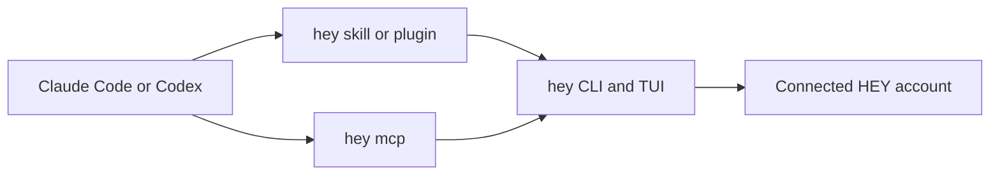

# basecamp/hey-cli

> CLI and TUI for HEY mail and calendar, usable by hand or by a coding agent.

## The problem
HEY has no command-line entry point: scripting mail or handing it to an agent is impossible.

## What it actually does
`hey` offers a terminal app (mail, contacts, calendar, journal) and commands: read a thread in Markdown, reply, compose, search, manage the new-senders screen filter, create events, stream new emails as JSON (`hey watch`). Redirected, outputs become JSON, filterable with `--jq`. `hey setup claude` installs the skill and plugin; `hey mcp` exposes the tools over MCP.

## How it is wired


## Trying it
```bash
mise use -g github:basecamp/hey-cli
hey
hey tui
hey box view imbox
hey search --from jane@example.com --date last_30_days
hey setup claude
claude mcp add hey -- hey mcp
```

## Cost and gotchas
Requires a HEY account, a paid service: the README doesn't state the price. The common install path uses a `curl | bash` script; review the script or prefer mise, Homebrew, or Nix.

## What it is not
Not a generic IMAP client: it only works with HEY. The service remains a closed SaaS.

## Alternatives
No alternative named in the README.

## For you
To watch: useful only if you use HEY; it's a good illustration of how to expose a service to an agent (CLI, skill, MCP).
