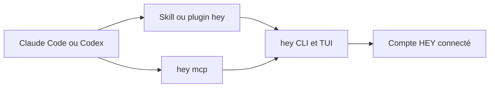

# basecamp/hey-cli

> CLI et TUI pour la messagerie et l'agenda HEY, utilisables à la main ou par un agent de code.

## Le problème
HEY n'a pas de point d'entrée en ligne de commande : impossible de scripter le courrier ou de le confier à un agent.

## Ce que ça fait vraiment
`hey` offre une application terminal (courrier, contacts, agenda, journal) et des commandes : lire un fil en Markdown, répondre, composer, chercher, gérer le filtre des nouveaux expéditeurs, créer des événements, suivre les nouveaux e-mails en JSON (`hey watch`). Redirigées, les sorties passent en JSON, filtrable par `--jq`. `hey setup claude` installe skill et plugin ; `hey mcp` expose les outils en MCP.

## Comment c'est branché


## Essayer
```bash
mise use -g github:basecamp/hey-cli
hey
hey tui
hey box view imbox
hey search --from jane@example.com --date last_30_days
hey setup claude
claude mcp add hey -- hey mcp
```

## Coût et pièges
Il faut un compte HEY, service payant : le README ne précise pas le tarif. L'installation courante passe par un script `curl | bash` ; relire le script ou préférer mise, Homebrew ou Nix.

## Ce que ce n'est pas
Pas un client IMAP générique : il ne marche qu'avec HEY. Le service reste un SaaS fermé.

## Alternatives
Aucune alternative nommée dans le README.

## Pour toi
À surveiller : utile seulement si tu utilises HEY ; il montre bien comment exposer un service à un agent (CLI, skill, MCP).

