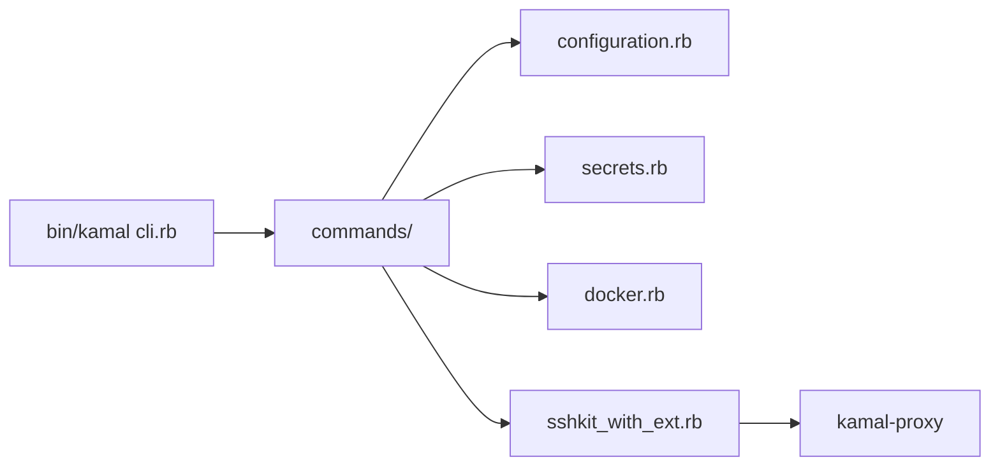

# basecamp/kamal

> Command-line tool to deploy containerized apps to servers with zero downtime.

## The problem
Deploying a web app to bare metal or VMs without going through Kubernetes or a PaaS.

## What it actually does
Ruby CLI: reads a configuration, manages secrets (adapters for external managers), builds the Docker image, runs commands on the servers through SSHKit and switches traffic between containers thanks to kamal-proxy. Designed for Rails, but works for any containerized app.

## How it is wired

## Trying it
No command in this short README: installation and commands are deferred to kamal-deploy.org.

## Cost and gotchas
Free; you need servers reachable over SSH and Docker. Minimal README, the rest is not documented here.

## What it is not
Not a container orchestrator: no multi-node scheduling like Kubernetes.

## Alternatives
No alternative named in the README.

## For you
Worth watching: handy for deploying a small API or a model dashboard on a VM; of little use for orchestrated ML workloads.
