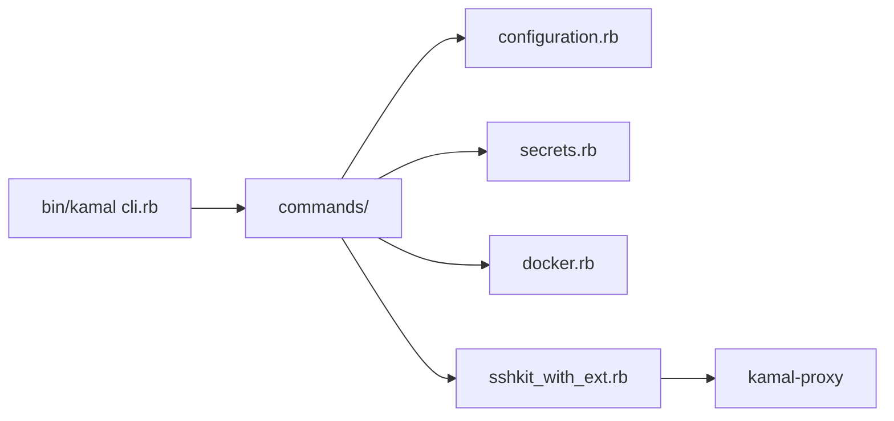

# basecamp/kamal

> Outil en ligne de commande pour déployer des applis conteneurisées sur serveurs, sans interruption.

## Le problème
Déployer une appli web sur du bare metal ou des VM sans passer par Kubernetes ni un PaaS.

## Ce que ça fait vraiment
CLI Ruby : lit une configuration, gère les secrets (adaptateurs pour gestionnaires externes), construit l'image Docker, exécute les commandes sur les serveurs via SSHKit et bascule le trafic entre conteneurs grâce à kamal-proxy. Conçu pour Rails, valable pour toute appli conteneurisée.

## Comment c'est branché

## Essayer
Aucune commande dans ce README court : installation et commandes renvoyées à kamal-deploy.org.

## Coût et pièges
Gratuit ; il faut des serveurs accessibles en SSH et Docker. README minimal, le reste n'est pas documenté ici.

## Ce que ce n'est pas
Pas un orchestrateur de conteneurs : pas de planification multi-nœuds comme Kubernetes.

## Alternatives
Aucune alternative nommée dans le README.

## Pour toi
Surveiller : pratique pour déployer une petite API ou un tableau de bord de modèle sur une VM ; peu utile pour des charges ML orchestrées.

