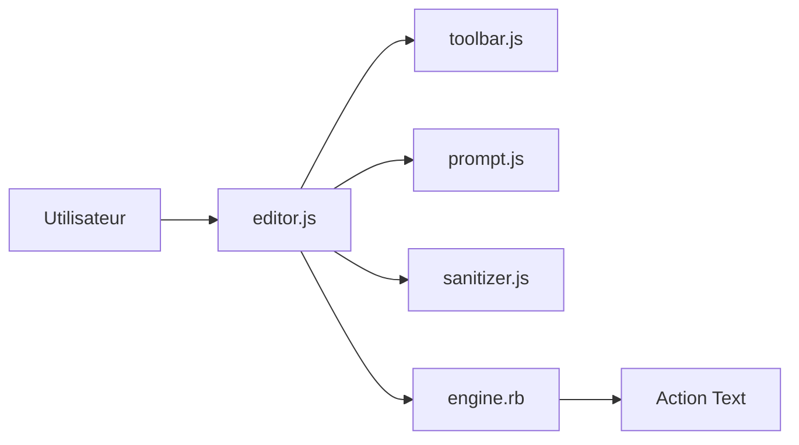

# basecamp/lexxy

> Rich text editor for Rails, based on Meta's Lexical, compatible with Action Text.

## The problem
Action Text's Trix editor is limited; a modern editor is needed that produces the same HTML Rails expects.

## What it actually does
Very short README (under 800 characters). It announces: Lexical base, good semantic HTML, Markdown shortcuts, code highlighting, configurable prompts (mentions), attachment previews. The code shows a Rails engine and a JS editor component with toolbar, tables and sanitizer.

## How it is wired

## Trying it
No command documented in the README; see the online documentation.

## Cost and gotchas
Free. Reserved for Rails applications. 102 open issues.

## What it is not
Not a generic editor independent of Rails.

## Alternatives
No alternative cited in the README.

## For you
Ignore: a front-end building block for Rails applications, unrelated to data or AI; too little material to judge further.
