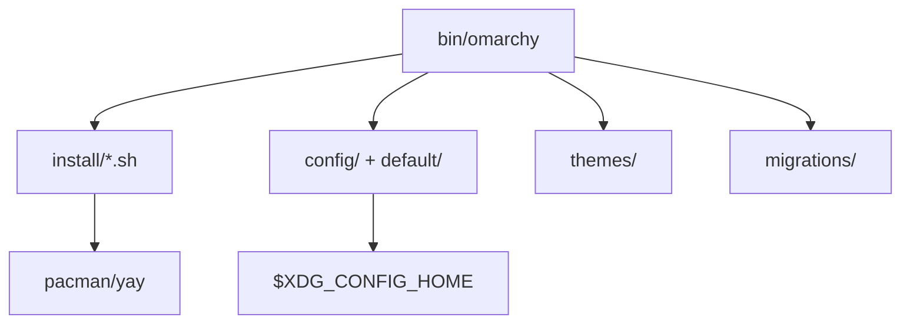

# basecamp/omarchy

> A Linux distribution inspired by Arch, pre-configured around Hyprland, for developers who want a ready-to-use environment.

## The problem
Setting up a consistent Linux development environment (including configuration files, themes, shortcuts, and tools) can take several days.

## What it actually does
A `boot.sh` script, followed by `install/*.sh` scripts, provision an Arch Linux system using pacman/yay, deploy configuration templates from `/config/` and `/default/`, apply a theme from `/themes/`, create `.desktop` entries, and run migration scripts for updates. The README file only contains the table of contents of the manual.

## How it is wired


## Trying it
```bash
# non documenté dans le README fourni (renvoi à omarchy.org et au dossier manual/)
```

## Cost and gotchas
Installation of an entire system: this requires a dedicated machine or a virtual machine. No license is required.

## What it is not
This is not a tool to be simply placed on an existing Linux system without any side effects, nor is it a data/AI project. The README is a simple summary: the details are in the manual.

## Alternatives
No alternative is specified in the README.

## For you
Monitor: Useful if you want a ready-made Hyprland setup, without direct involvement with data, AI, or MLOps.
