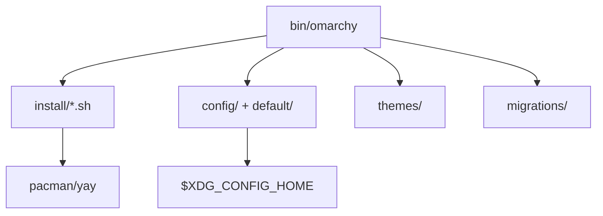

# basecamp/omarchy

> Distribution Linux d'inspiration Arch, préconfigurée autour de Hyprland, pour développeurs qui veulent un poste prêt à l'emploi.

## Le problème
Monter un environnement de dev Linux cohérent (compositeur, thèmes, raccourcis, outils) demande des jours de dotfiles.

## Ce que ça fait vraiment
Un script `boot.sh` puis des scripts `install/*.sh` provisionnent une Arch avec pacman/yay, déploient des gabarits de `config/` et `default/`, appliquent un thème de `themes/`, enregistrent des entrées `.desktop` et jouent des `migrations/` pour les mises à jour. Le README ne contient que le sommaire du manuel.

## Comment c'est branché


## Essayer
```bash
# non documenté dans le README fourni (renvoi à omarchy.org et au dossier manual/)
```

## Coût et pièges
Installation de tout un système : à réserver à une machine dédiée ou une VM. Aucune clé requise.

## Ce que ce n'est pas
Ce n'est pas un outil à poser sur un Linux existant sans effet de bord, ni un projet data/IA. Le README est un simple sommaire : les détails sont dans le manuel.

## Alternatives
Aucune alternative nommée dans le README.

## Pour toi
Surveiller : utile si tu veux un poste Hyprland clé en main, sans rapport direct avec data/IA/MLOps.

