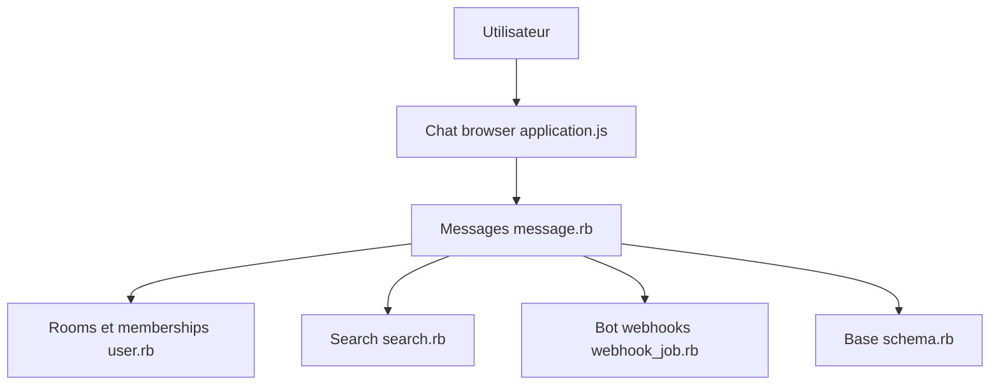

# basecamp/once-campfire

> Self-hosted web chat application (rooms, direct messages, attachments) for small teams.

## The problem
Teams that want internal messaging without depending on a SaaS need a product that is simple to host.

## What it actually does
Rails application shipped as a single Docker image (web, jobs, cache, files, SSL): rooms with access control, direct messages, attachments with previews, search, Web Push notifications, mentions, a bot API (webhooks). Setup wizard for the admin account on first start. SQLite database. The README also compares reimplementations in Django, Go, Rust, C.

## How it is wired


## Trying it
```bash
curl https://get.once.com | sh
once deploy ghcr.io/basecamp/once-campfire --host chat.example.com
```

## Cost and gotchas
Free. A server and a domain name are at your expense. The admin's e-mail is visible on the login page. Forms have no CSRF token (protection is through headers).

## What it is not
Not an AI tool. The throughput figures in the table compare different implementations on a single piece of hardware.

## Alternatives
No alternative named in the README.

## For you
Off-topic for AI: only interesting for hosting team messaging; ignore it if that is not your need.
