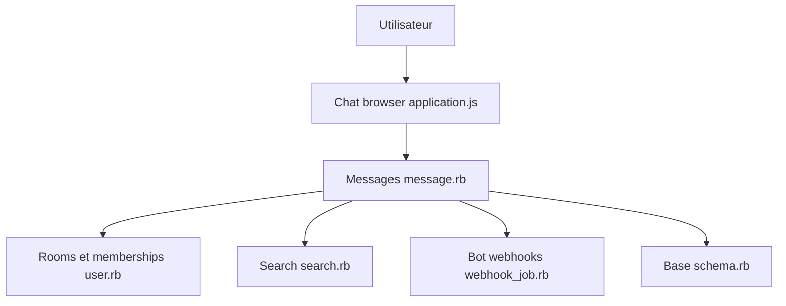

# basecamp/once-campfire

> Application de discussion web auto-hébergée (salons, messages directs, pièces jointes) pour petites équipes.

## Le problème
Les équipes qui veulent une messagerie interne sans dépendre d'un SaaS ont besoin d'un produit simple à héberger.

## Ce que ça fait vraiment
Application Rails fournie en une image Docker unique (web, tâches, cache, fichiers, SSL) : salons avec accès, messages directs, pièces jointes avec aperçu, recherche, notifications Web Push, mentions, API pour robots (webhooks). Assistant de création du compte admin au premier démarrage. Base SQLite. Le README compare aussi des réimplémentations en Django, Go, Rust, C.

## Comment c'est branché


## Essayer
```bash
curl https://get.once.com | sh
once deploy ghcr.io/basecamp/once-campfire --host chat.example.com
```

## Coût et pièges
Gratuit. Un serveur et un nom de domaine sont à ta charge. L'e-mail de l'admin est visible sur la page de connexion. Les formulaires n'ont pas de jeton CSRF (protection par en-têtes).

## Ce que ce n'est pas
Pas un outil IA. Les chiffres de débit de la table comparent des implémentations différentes sur un seul matériel.

## Alternatives
Aucune alternative nommée dans le README.

## Pour toi
Hors sujet IA : intéressant seulement pour héberger une messagerie d'équipe ; ignore-le s'il ne s'agit pas de ton besoin.

