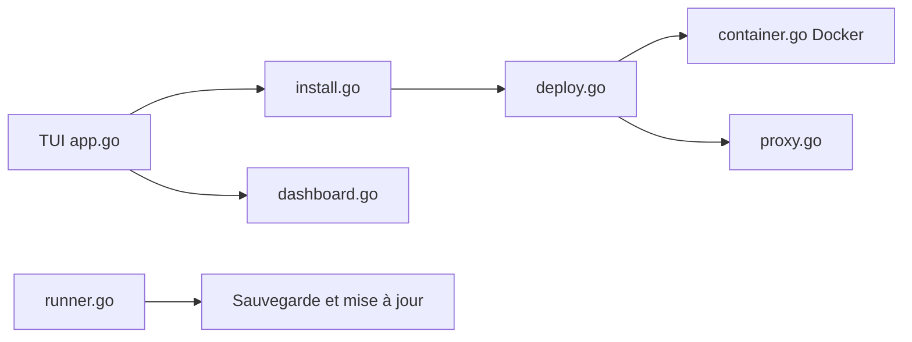

# basecamp/once

> Terminal platform to install and manage self-hosted Docker web applications, with backups and updates.

## The problem
Self-hosting applications requires configuring containers, HTTPS proxy, backups and updates by hand.

## What it actually does
A `once` binary (TUI and CLI) installs a Docker image, configures a hostname, starts the container behind an HTTP proxy, then offers a dashboard. Backups to a chosen location, automatic updates, background service, metrics. Ships 37signals applications and accepts any compatible image: HTTP on port 80, a `/up` route, data in `/storage`, optional `pre-backup` and `post-restore` scripts.

## How it is wired


## Trying it
```bash
curl https://get.once.com | sh
curl https://get.once.com | ONCE_INTERACTIVE=false sh
sudo once background install
once --help
```

## Cost and gotchas
Linux or macOS, Docker (installed by the script if missing). A DNS record pointing to the machine is required. With Cloudflare as proxy, SSL mode "Strict". The `curl | sh` script should be inspected before running.

## What it is not
Not a multi-server orchestrator like Kubernetes. Some of the bundled applications are 37signals products, unrelated to AI. The usage statistics collected are not described in the README.

## Alternatives
No alternative named in the README.

## For you
Keep an eye on it: handy for hosting internal tools (dashboards, wikis) packaged as containers on a small server, with no direct relevance to AI.
