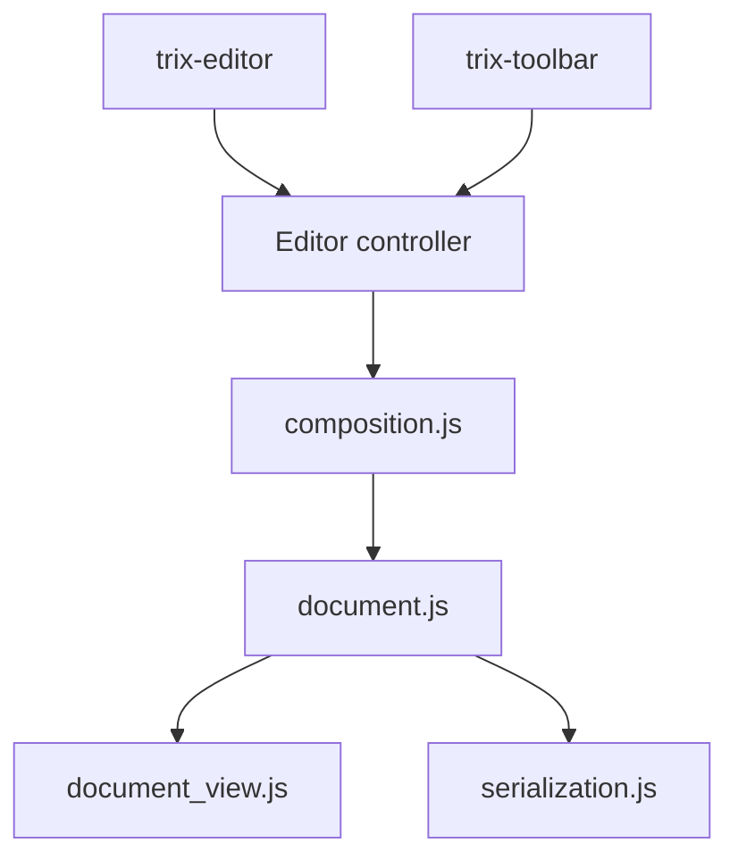

# basecamp/trix

> WYSIWYG rich text editor for web applications, from 37signals, for front-end developers.

## The problem
Editors based on `contenteditable` and `execCommand` behave differently across browsers. Producing clean, consistent HTML becomes painful.

## What it actually does
Trix treats `contenteditable` as a mere input device: every keystroke becomes an operation on an immutable internal document model, which is then re-rendered. It handles attachments (drag and drop, upload left for you to implement), unlimited undo, sanitization via DOMPurify, and form integration via Element Internals.

## How it is wired


## Trying it
```bash
yarn install
yarn build
yarn start
yarn test
```
```html
<input id="x" type="hidden" name="content">
<trix-editor input="x"></trix-editor>
```

## Cost and gotchas
Free. Never put untrusted HTML directly inside the `<trix-editor>` tag (README warning). File upload is up to you.

## What it is not
It is not a collaborative editor nor a Markdown editor: it targets messages, comments and simple lists.

## Alternatives
The README names none.

## For you
Ignore for data/AI/MLOps work: it is a front-end text-input building block, useful only if you build a web interface (notably Rails).
