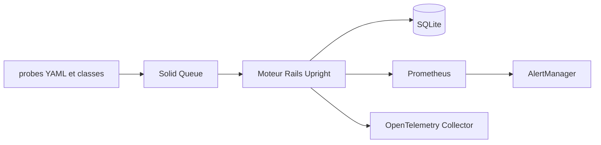

# basecamp/upright

> Self-hosted synthetic monitoring system that runs probes from several sites and exports to Prometheus.

## The problem
Knowing that a service is down, as seen from several regions, without paying for a monitoring SaaS.

## What it actually does
A Rails engine that runs HTTP, SMTP, MCP, traceroute and Playwright probes (browser journeys with video) on a Solid Queue schedule. Each site runs on its own server. Results go into SQLite, metrics into Prometheus and alerts into AlertManager. Notifications are not included.

## How it is wired
Simplified diagram based on the sheet, no diagram provided.


## Trying it
```bash
rails new my-upright --database=sqlite3 --skip-test
cd my-upright
bundle add upright
bin/rails generate upright:install
bin/rails db:prepare
bin/dev
```

## Cost and gotchas
Free, but you need VPSs (2 vCPU, 2 to 4 GB of RAM each) and Kamal for deployment. Deployment requires Ruby and Rails, which are absent from the prerequisites list. Outbound port 25 is often blocked by hosting providers, which hampers SMTP probes.

## What it is not
It is not a turnkey application: it installs into your own Rails application. It provides neither hosting nor notifications.

## Alternatives
Not documented in the README.

## For you
Worth watching: relevant for MLOps if you monitor inference endpoints from several regions, but the Rails and Kamal stack is heavy to adopt outside the Ruby ecosystem.
