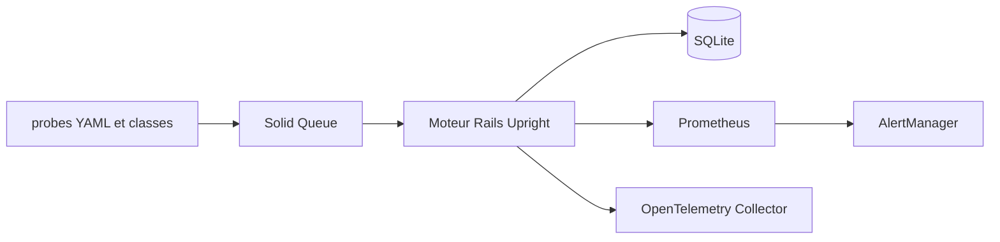

# basecamp/upright

> Système de supervision synthétique auto-hébergé qui lance des sondes depuis plusieurs sites et exporte vers Prometheus.

## Le problème
Savoir qu'un service est tombé, vu de plusieurs régions, sans payer un SaaS de monitoring.

## Ce que ça fait vraiment
Moteur Rails qui exécute des sondes HTTP, SMTP, MCP, traceroute et Playwright (parcours navigateur avec vidéo) selon un calendrier Solid Queue. Chaque site tourne sur son propre serveur. Les résultats vont dans SQLite, les métriques dans Prometheus et les alertes dans AlertManager. Les notifications ne sont pas incluses.

## Comment c'est branché
Schéma simplifié d'après la fiche, sans diagramme fourni.


## Essayer
```bash
rails new my-upright --database=sqlite3 --skip-test
cd my-upright
bundle add upright
bin/rails generate upright:install
bin/rails db:prepare
bin/dev
```

## Coût et pièges
Gratuit, mais il faut des VPS (2 vCPU, 2 à 4 Go de RAM chacun) et Kamal pour le déploiement. Le déploiement demande Ruby et Rails, absents de la liste des prérequis. Le port 25 sortant est souvent bloqué par les hébergeurs, ce qui gêne les sondes SMTP.

## Ce que ce n'est pas
Ce n'est pas une application clé en main : elle s'installe dans sa propre application Rails. Elle ne fournit ni hébergement ni notifications.

## Alternatives
Non documenté dans le README.

## Pour toi
À surveiller : pertinent pour le MLOps si tu supervises des endpoints d'inférence depuis plusieurs régions, mais la pile Rails et Kamal est lourde à adopter hors écosystème Ruby.

