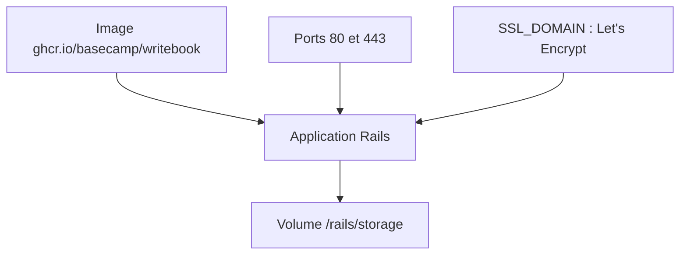

# basecamp/writebook

> Self-hosted web application for publishing books in Markdown, private or public.

## The problem
Publishing a book or documentation online requires a publisher or a site you build yourself.

## What it actually does
Rails application distributed as a Docker image: you write in Markdown, organize into chapters, image pages and title pages, then publish privately or publicly with search. Installation goes through ONCE or `docker run`. SSL via Let's Encrypt with `SSL_DOMAIN`.

## How it is wired
Simplified diagram based on the sheet, no diagram provided.



## Trying it
```bash
curl https://get.once.com/writebook | sh
# développement :
bin/setup
bin/dev
```

## Cost and gotchas
Free; Docker and a server of your own. Mount a volume on `/rails/storage`, otherwise data is lost.

## What it is not
Not a static site generator nor a team wiki. The README describes no API.

## Alternatives
No alternative named in the README.

## For you
Ignore: a book-editing tool, unrelated to data / AI / MLOps work.
