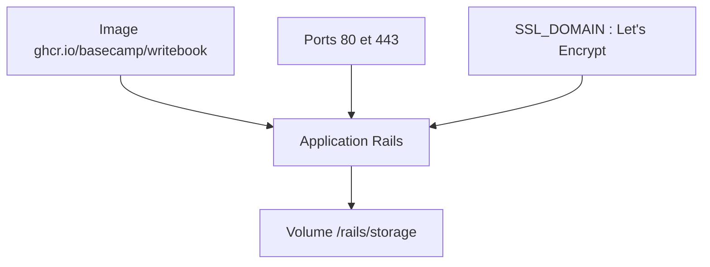

# basecamp/writebook

> Application web auto-hébergée pour publier des livres en Markdown, privés ou publics.

## Le problème
Publier un livre ou une documentation en ligne exige un éditeur ou un site à construire soi-même.

## Ce que ça fait vraiment
Application Rails distribuée en image Docker : on écrit en Markdown, on organise en chapitres, pages d'images et pages de titre, puis on publie en privé ou en public avec recherche. L'installation passe par ONCE ou par `docker run`. SSL via Let's Encrypt avec `SSL_DOMAIN`.

## Comment c'est branché
Schéma simplifié d'après la fiche, sans diagramme fourni.



## Essayer
```bash
curl https://get.once.com/writebook | sh
# développement :
bin/setup
bin/dev
```

## Coût et pièges
Gratuit ; Docker et un serveur à toi. Monter un volume sur `/rails/storage`, sinon les données sont perdues.

## Ce que ce n'est pas
Pas un générateur de site statique ni un wiki d'équipe. Le README ne décrit aucune API.

## Alternatives
Aucune alternative nommée dans le README.

## Pour toi
Ignorer : outil d'édition de livres, sans rapport avec un travail data / IA / MLOps.

