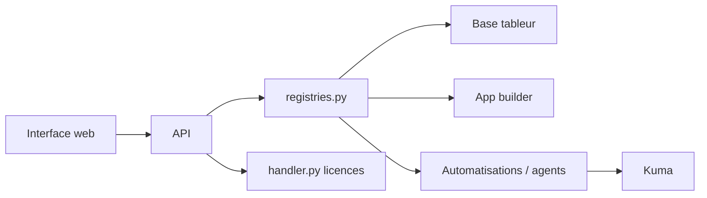

# baserow/baserow

> Open-source no-code platform for databases, apps, automations and AI agents, an Airtable alternative.

## The problem
Non-technical teams want to structure data and build internal tools without a developer or an Airtable subscription.

## What it actually does
A spreadsheet-database (Django, Vue.js, PostgreSQL) with a REST API, an app builder whose apps can be published on your own domain, dashboards, automations, AI agents and an assistant named Kuma. Deployment through Docker, Helm, Docker Compose or platforms (Heroku, Render, AWS…). The core is under MIT; premium and enterprise features have a separate license.

## How it is wired


## Trying it
```bash
docker run -v baserow_data:/baserow/data -p 80:80 -p 443:443 baserow/baserow:2.3.4
```

## Cost and gotchas
Self-hosting is free; premium/enterprise features are paid. The AI assistant and agents assume a model provider (not detailed in the README). The catalog does not identify the license although the README states MIT: to be verified.

## What it is not
Not a data science tool: it is a no-code database. The "SOC 2 / HIPAA compliant" label applies to the cloud offering announced by the vendor.

## Alternatives
- Airtable: the targeted product, cited in the README.

## For you
Worth watching: handy for exposing data to business teams or annotating datasets, without replacing a data warehouse.
