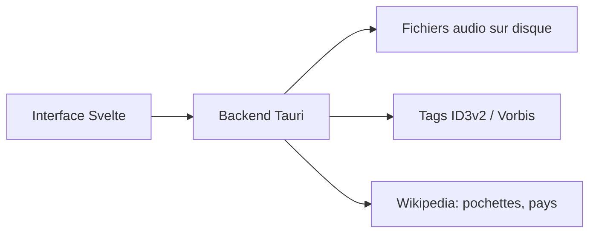

# basharovV/musicat

> Local music library player (Svelte and Tauri) with tagger, world map and statistics.

## The problem
Streaming services pull people away from their local collection; a modern player to browse it is missing.

## What it actually does
Plays MP3, FLAC, WAV, AAC and OGG without copying the files, gapless playback, ID3v2 and Vorbis tagger, folder watching, smart playlists, cover art and lyrics, map view, statistics and mini-player.

## How it is wired
Simplified diagram based on the sheet, no diagram provided.



## Trying it
```bash
npm install
npm run tauri dev
```

## Cost and gotchas
Free. On Linux, ALSA is required (`libasound2-dev`). On macOS, the application is not signed: `xattr -d com.apple.quarantine /Applications/Musicat.app`.

## What it is not
Not stable: version 0.x, the README warns that things may break. No connection to data, AI or MLOps.

## Alternatives
No alternative cited in the README.

## For you
Ignore: personal music player in version 0.x, unrelated to data, AI or MLOps work.
