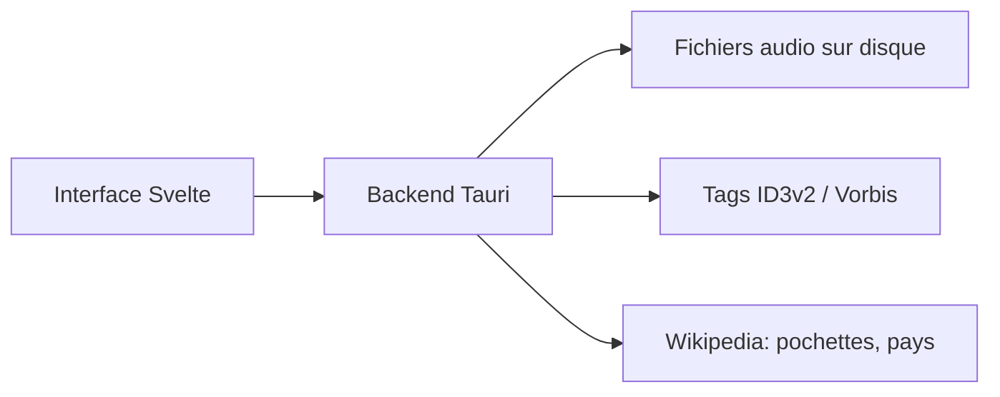

# basharovV/musicat

> Lecteur de bibliothèque musicale locale (Svelte et Tauri) avec tagueur, carte du monde et statistiques.

## Le problème
Les services de streaming éloignent de sa collection locale ; il manque un lecteur moderne pour la parcourir.

## Ce que ça fait vraiment
Lecture MP3, FLAC, WAV, AAC et OGG sans copier les fichiers, lecture sans blanc, tagueur ID3v2 et Vorbis, surveillance des dossiers, playlists intelligentes, pochettes et paroles, vue carte, statistiques et mini-lecteur.

## Comment c'est branché
Schéma simplifié d'après la fiche, sans diagramme fourni.



## Essayer
```bash
npm install
npm run tauri dev
```

## Coût et pièges
Gratuit. Sous Linux, il faut ALSA (`libasound2-dev`). Sous macOS, l'application n'est pas signée : `xattr -d com.apple.quarantine /Applications/Musicat.app`.

## Ce que ce n'est pas
Pas stable : version 0.x, le README prévient que des choses peuvent casser. Aucun lien avec data, IA ou MLOps.

## Alternatives
Aucune alternative citée dans le README.

## Pour toi
Ignorer : lecteur musical personnel en version 0.x, sans rapport avec un travail data, IA ou MLOps.

