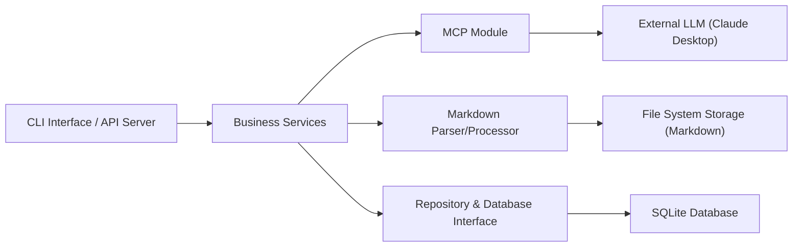

# basicmachines-co/basic-memory

> MCP server that gives AI assistants a persistent memory, written as local Markdown notes.

## The problem
Conversations with an LLM are ephemeral: what was decided or learned disappears from one session to the next.

## What it actually does
The MCP server writes and reads Markdown notes on your disk (in `~/basic-memory` by default). Each note contains observations and relations as wikilinks, which form a knowledge graph. A SQLite (or Postgres) index enables text and semantic search, with optional reranking. It works with Claude Desktop, Claude Code, Codex, Cursor, VS Code and ChatGPT, and the notes remain readable in Obsidian. A paid cloud offer adds synchronization and backups.

## How it is wired


## Trying it
```bash
uv tool install basic-memory --prerelease=allow
claude mcp add basic-memory -- uvx --prerelease=allow basic-memory mcp
basic-memory project add research ~/research
export BASIC_MEMORY_NO_PROMOS=1
```

## Cost and gotchas
Local use is free. The `--prerelease=allow` flag is mandatory: version 0.23 depends on a prerelease of FastMCP 4. The cloud costs $15/month (7-day trial). Telemetry is anonymous (promotions and cloud connections to Umami); `BASIC_MEMORY_NO_PROMOS=1` disables it.

## What it is not
Not a vector database nor a RAG over documents: the notes are written by the agent or by you. The AGPL-3.0 license is copyleft: it matters mostly if you host the modified code as a service.

## Alternatives
No alternative named in the README (it only cites categories: chat history, RAG, vector databases).

## For you
To adopt locally if you use Claude Code or Cursor daily: the notes remain your own files, and the cloud is optional; disable telemetry and check the AGPL before any use as a service.
