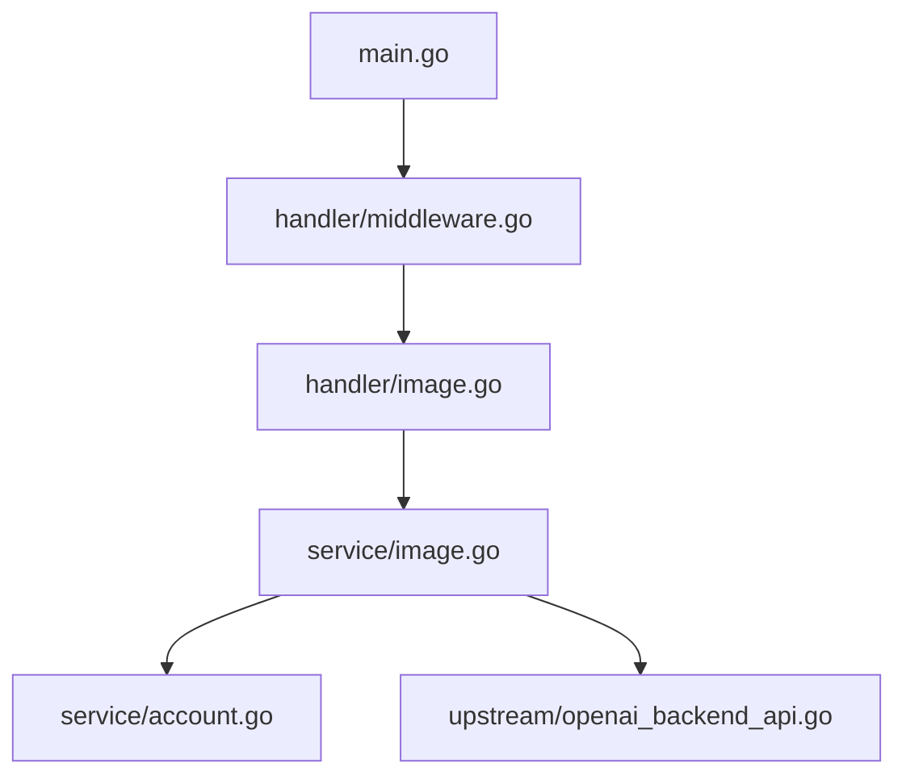

# basketikun/chatgpt2api

> OpenAI-compatible gateway that exploits ChatGPT accounts through reverse engineering, for images, voice and search.

## The problem
The official OpenAI API is paid by volume; the author wants to use the capabilities of ChatGPT accounts from an API.

## What it actually does
Exposes routes close to OpenAI's (images, edits, voice, transcription, chat, responses) fed by a pool of ChatGPT accounts. Handles token refresh, removal of invalid accounts, proxies (WARP, FlareSolverr) and a creation interface. The code calls ChatGPT's backend and solves a proof of work.

## How it is wired


## Trying it
```bash
git clone git@github.com:basketikun/chatgpt2api.git
cd chatgpt2api
docker compose up -d
# définir api-key dans config.yaml, panneau sur http://localhost:3000
```

## Cost and gotchas
You need ChatGPT accounts (some routes require Plus, Team or Pro). Risk of account rate limiting or banning, stated by the author. Commercial and mass use is explicitly forbidden.

## What it is not
Neither an official API nor a complete generic proxy: chat and responses are limited. Not safe to use with an important account.

## Alternatives
No alternative named in the README.

## For you
Ignore: based on reverse engineering that violates OpenAI's terms; use the official API for serious work.
