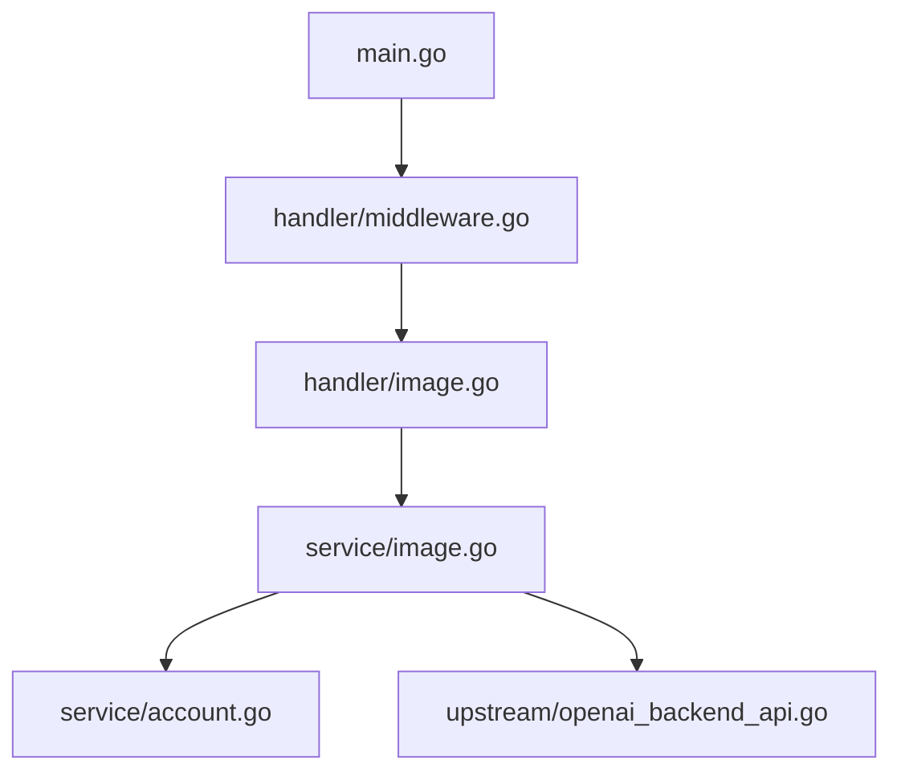

# basketikun/chatgpt2api

> Passerelle compatible OpenAI qui exploite des comptes ChatGPT par rétro-ingénierie, pour images, voix et recherche.

## Le problème
L'API OpenAI officielle est payante au volume ; l'auteur cherche à utiliser les capacités des comptes ChatGPT depuis une API.

## Ce que ça fait vraiment
Expose des routes proches d'OpenAI (images, éditions, voix, transcription, chat, responses) alimentées par un pool de comptes ChatGPT. Gère le rafraîchissement des jetons, le retrait des comptes invalides, les proxys (WARP, FlareSolverr) et une interface de création. Le code appelle le backend de ChatGPT et résout une preuve de travail.

## Comment c'est branché


## Essayer
```bash
git clone git@github.com:basketikun/chatgpt2api.git
cd chatgpt2api
docker compose up -d
# définir api-key dans config.yaml, panneau sur http://localhost:3000
```

## Coût et pièges
Il faut des comptes ChatGPT (certaines voies exigent Plus, Team ou Pro). Risque de limitation ou de bannissement des comptes, dit par l'auteur. Usage commercial et massif explicitement interdit.

## Ce que ce n'est pas
Ni une API officielle ni un proxy générique complet : chat et responses sont limités. Pas un usage sûr avec un compte important.

## Alternatives
Aucune alternative nommée dans le README.

## Pour toi
À ignorer : basé sur de la rétro-ingénierie qui viole les conditions d'OpenAI ; utilise l'API officielle pour un travail sérieux.

