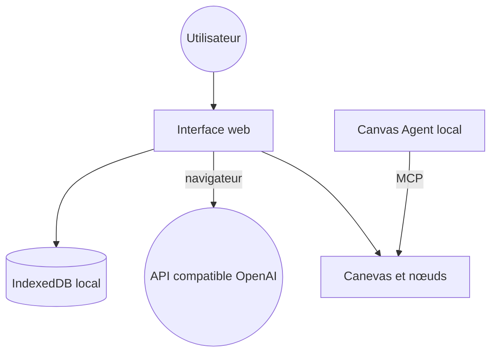

# basketikun/infinite-canvas

> Infinite-canvas workshop for creating images with AI models, via OpenAI-compatible APIs.

## The problem
Iterating on generated images means juggling between tools for prompts, references and results.

## What it actually does
A node-based canvas (drag, link, undo, import/export) where you generate and edit images, video and audio with an OpenAI-compatible API called from the browser. A canvas assistant, a prompt library (7 sources), node plugins by URL and a local agent linked to Codex or Claude Code through MCP. Data is stored in the browser.

## How it is wired


## Trying it
```bash
cd web
bun install
bun run dev
docker compose up -d
```

## Cost and gotchas
API key and Base URL at your expense (billed per image or video). The README is dense with API reseller advertisements.

## What it is not
Not stable: the README warns that storage formats may change without compatibility. Not a reproducible pipeline tool.

## Alternatives
- chatgpt2api (cited): to obtain a free image-generation API.

## For you
Ignore: a creative tool under development, sponsor-driven, with no direct value for a data/AI/MLOps workflow.
