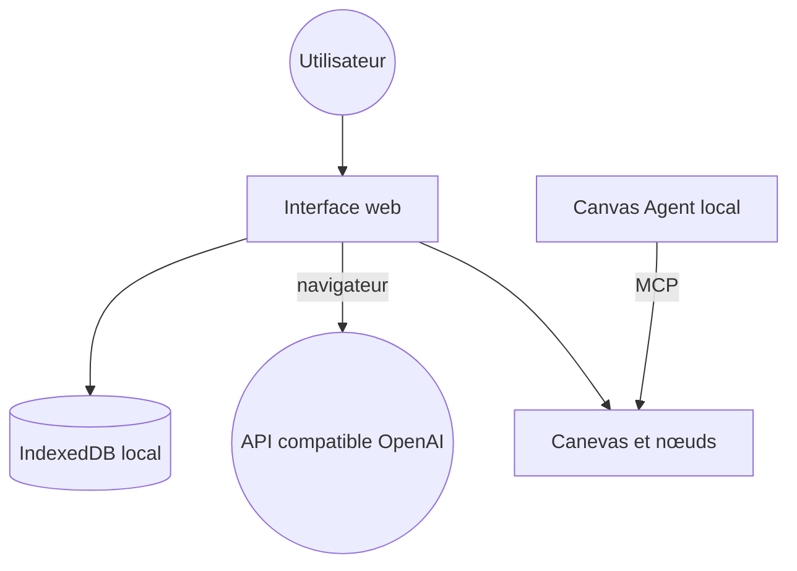

# basketikun/infinite-canvas

> Atelier à canevas infini pour créer des images avec des modèles IA, via des API compatibles OpenAI.

## Le problème
Itérer sur des images générées exige de jongler entre outils pour prompts, références et résultats.

## Ce que ça fait vraiment
Un canevas à nœuds (glisser, lier, annuler, importer/exporter) où l'on génère et édite des images, vidéos et audio avec une API compatible OpenAI appelée depuis le navigateur. Un assistant de canevas, une bibliothèque de prompts (7 sources), des plugins de nœuds par URL et un agent local relié à Codex ou Claude Code par MCP. Données stockées dans le navigateur.

## Comment c'est branché


## Essayer
```bash
cd web
bun install
bun run dev
docker compose up -d
```

## Coût et pièges
Clé et Base URL d'une API à ta charge (facturation à l'image ou à la vidéo). Le README est dense en publicités de revendeurs d'API.

## Ce que ce n'est pas
Pas stable : le README avertit que les formats de stockage peuvent changer sans compatibilité. Pas un outil de pipeline reproductible.

## Alternatives
- chatgpt2api (cité) : pour obtenir une API de génération d'image gratuite.

## Pour toi
À ignorer : outil créatif en développement, orienté sponsors, sans valeur directe pour un flux data/IA/MLOps.

