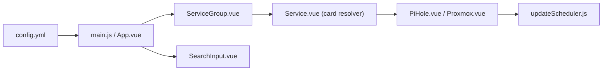

# bastienwirtz/homer

> Static home page for a personal server, driven by a YAML file.

## The problem
A home server quickly hosts dozens of services whose links you need to keep within reach.

## What it actually does
Static Vue dashboard: reads `assets/config.yml`, displays services grouped as cards, with fuzzy search, themes, multiple pages, PWA. Specialized cards (Pi-hole, Proxmox…) query the services' APIs, refreshed by a scheduler. Must be served by an HTTP server: `file://` does not work.

## How it is wired


## Trying it
```bash
docker run -d --name homer -p 8080:8080 \
  --mount type=bind,source="/path/to/config/dir",target=/www/assets \
  --restart=unless-stopped b4bz/homer:latest
```

## Cost and gotchas
Free. The config folder must be owned by user 1000 by default. Service API keys may be stored in the YAML.

## What it is not
Not a monitoring tool: it displays links and a few statuses. Static, no backend.

## Alternatives
No alternative named in the README.

## For you
Watch for your home MLOps lab: lightweight and simple, to launch to group your self-hosted tools (MLflow, Grafana…).
