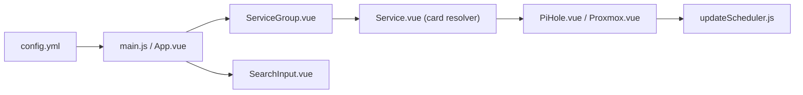

# bastienwirtz/homer

> Page d'accueil statique pour serveur perso, pilotée par un fichier YAML.

## Le problème
Un serveur maison héberge vite des dizaines de services dont il faut garder les liens à portée.

## Ce que ça fait vraiment
Tableau de bord Vue statique : lit `assets/config.yml`, affiche des services groupés en cartes, avec recherche floue, thèmes, pages multiples, PWA. Des cartes spécialisées (Pi-hole, Proxmox…) interrogent les API des services, rafraîchies par un ordonnanceur. Doit être servi par un serveur HTTP : `file://` ne fonctionne pas.

## Comment c'est branché


## Essayer
```bash
docker run -d --name homer -p 8080:8080 \
  --mount type=bind,source="/path/to/config/dir",target=/www/assets \
  --restart=unless-stopped b4bz/homer:latest
```

## Coût et pièges
Gratuit. Le dossier de config doit appartenir à l'utilisateur 1000 par défaut. Des clés d'API de services peuvent être stockées dans le YAML.

## Ce que ce n'est pas
Pas un outil de supervision : il affiche des liens et quelques états. Statique, sans backend.

## Alternatives
Aucune alternative nommée dans le README.

## Pour toi
À surveiller pour ton labo MLOps maison : léger et simple, à lancer pour regrouper tes outils auto-hébergés (MLflow, Grafana…).

