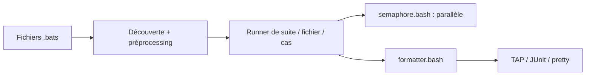

# bats-core/bats-core

> TAP-compatible Bash testing framework, for testing shell scripts and UNIX programs.

## The problem
Shell scripts have no tests, so regressions go unnoticed.

## What it actually does
A `.bats` file is a Bash script where `@test "..."` defines a case. Each test runs with `errexit`: any non-zero return code makes it fail. The project discovers and runs the files, then renders results in pretty, TAP, TAP13 or JUnit formats. A module handles parallelism.

## How it is wired


## Trying it
```bash
bin/bats --tap test
```

## Cost and gotchas
Free. Bash 3.2 or later. Tests must be written with `errexit` in mind: a failing line stops the case.

## What it is not
Not limited to Bash: can test any UNIX program. It is the community continuation of the old Bats, archived in 2021.

## Alternatives
- sstephenson/bats: original, archived, to avoid.

## For you
Adopt it to test the shell scripts of an MLOps pipeline: simple, MIT, maintained.
