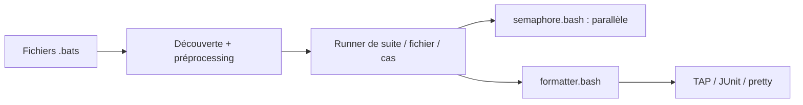

# bats-core/bats-core

> Framework de tests Bash compatible TAP, pour tester scripts shell et programmes UNIX.

## Le problème
Les scripts shell n'ont pas de tests, donc les régressions passent inaperçues.

## Ce que ça fait vraiment
Un fichier `.bats` est un script Bash où `@test "..."` définit un cas. Chaque test s'exécute avec `errexit` : tout code retour non nul fait échouer. Le projet découvre et exécute les fichiers, puis rend les résultats en formats pretty, TAP, TAP13 ou JUnit. Un module gère le parallélisme.

## Comment c'est branché


## Essayer
```bash
bin/bats --tap test
```

## Coût et pièges
Gratuit. Bash 3.2 ou plus. Les tests doivent être écrits avec `errexit` en tête : une ligne qui échoue arrête le cas.

## Ce que ce n'est pas
Pas limité à Bash : peut tester n'importe quel programme UNIX. C'est la suite communautaire de l'ancien Bats archivé en 2021.

## Alternatives
- sstephenson/bats : original, archivé, à éviter.

## Pour toi
À adopter pour tester les scripts shell d'un pipeline MLOps : simple, MIT, maintenu.

