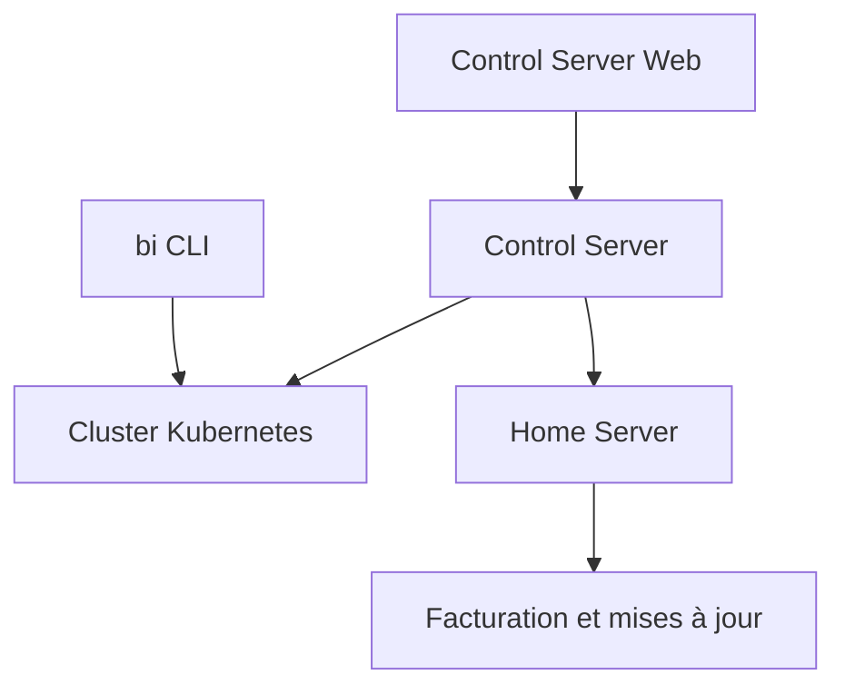

# batteries-included/batteries-included

> Turnkey Kubernetes infrastructure platform (databases, monitoring, Jupyter, Ollama), for small teams.

## The problem
Assembling databases, monitoring, certificates and SSO on Kubernetes takes a lot of YAML.

## What it actually does
An interface that deploys PostgreSQL, Redis, FerretDB, pgvector, Jupyter, Ollama, Grafana and VictoriaMetrics, with certificates and Keycloak SSO. The repository is an Elixir/Phoenix monorepo (control server, central billing server, shared UI). GPU support is announced as "coming soon".

## How it is wired
Simplified diagram based on the sheet, no diagram provided.



## Trying it
```bash
bi start bootstrap/local.spec.json
bix local bootstrap
bix local dev
```

## Cost and gotchas
An account on batteriesincl.com is expected; the local install without an account stops after a few hours because it cannot report its status. Linux recommended, Docker required.

## What it is not
Not fully standalone: the central server handles billing. The repository is archived.

## Alternatives
None cited in the README.

## For you
Ignore: archived repository, dependent on a central service, and the local install expires.
