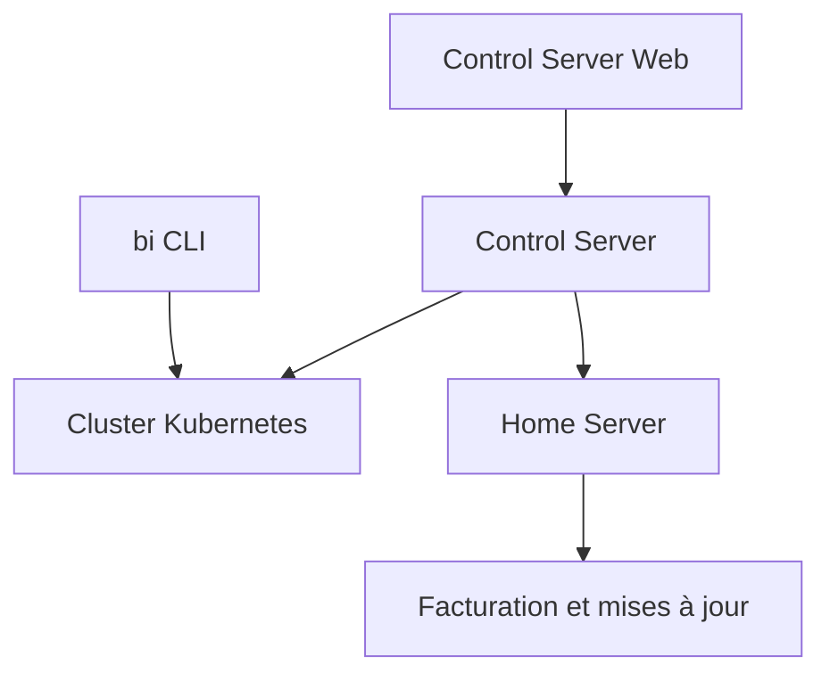

# batteries-included/batteries-included

> Plateforme d'infrastructure Kubernetes clé en main (bases, monitoring, Jupyter, Ollama), pour petites équipes.

## Le problème
Assembler bases de données, monitoring, certificats et SSO sur Kubernetes demande beaucoup de YAML.

## Ce que ça fait vraiment
Une interface qui déploie PostgreSQL, Redis, FerretDB, pgvector, Jupyter, Ollama, Grafana et VictoriaMetrics, avec certificats et SSO Keycloak. Le dépôt est un monorepo Elixir/Phoenix (serveur de contrôle, serveur central de facturation, UI commune). Le GPU est annoncé « bientôt ».

## Comment c'est branché
Schéma simplifié d'après la fiche, sans diagramme fourni.



## Essayer
```bash
bi start bootstrap/local.spec.json
bix local bootstrap
bix local dev
```

## Coût et pièges
Un compte sur batteriesincl.com est prévu ; l'installation locale sans compte s'arrête après quelques heures faute de pouvoir signaler son statut. Linux recommandé, Docker nécessaire.

## Ce que ce n'est pas
Pas totalement autonome : le serveur central gère la facturation. Dépôt archivé.

## Alternatives
Aucune citée dans le README.

## Pour toi
À ignorer : dépôt archivé, dépendant d'un service central, et l'installation locale expire.

