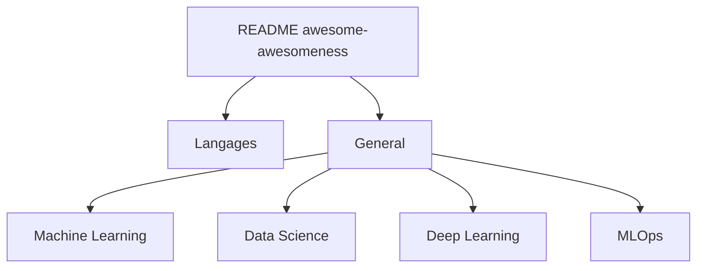

# bayandin/awesome-awesomeness

> A list of "awesome" lists sorted by language and by theme, to quickly find the right resource.

## The problem
There are hundreds of "awesome" lists scattered around; knowing which one exists on a given subject means searching everywhere.

## What it actually does
The README is an index: programming languages (Python, Go, Rust, etc.), then general themes. On the data/AI side it has Artificial intelligence, Big data, Data Science, Data Visualization, Datasets, Deep Learning, Machine Learning, MLOps, NLP (Speech and Natural Language Processing), Jupyter, Papers. Each entry points to another list; the links themselves are not visible in the excerpt.

## How it is wired
No code: a single README.

## Trying it
No documented command: browse the README on GitHub.

## Cost and gotchas
Free. Last push in June 2024: some target links or lists may be dead. No license declared.

## What it is not
Not content in itself: each entry is another list whose quality varies. No documented sorting criterion.

## Alternatives
None named in the README.

## For you
Worth bookmarking: useful for spotting MLOps, Deep Learning or Datasets lists, but frozen since 2024 and unlicensed, so treat it as a directory rather than an up-to-date source.
