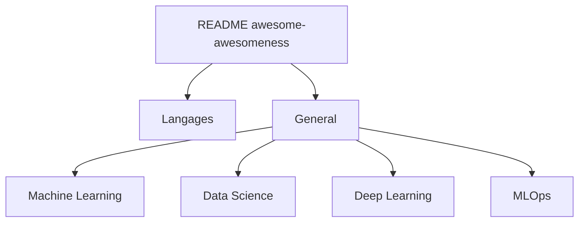

# bayandin/awesome-awesomeness

> Liste de listes « awesome » classées par langage et par thème, pour trouver vite la bonne ressource.

## Le problème
Il existe des centaines de listes « awesome » dispersées ; savoir laquelle existe sur un sujet demande de chercher partout.

## Ce que ça fait vraiment
Le README est un index : langages de programmation (Python, Go, Rust, etc.), puis thèmes généraux. Côté data/IA on y trouve Artificial intelligence, Big data, Data Science, Data Visualization, Datasets, Deep Learning, Machine Learning, MLOps, NLP (Speech and Natural Language Processing), Jupyter, Papers. Chaque entrée pointe vers une autre liste ; les liens eux-mêmes ne sont pas visibles dans l'extrait.

## Comment c'est branché
Aucun code : un README unique.

## Essayer
Aucune commande documentée : parcourir le README sur GitHub.

## Coût et pièges
Gratuit. Dernier push en juin 2024 : des liens ou listes cibles peuvent être morts. Aucune licence déclarée.

## Ce que ce n'est pas
Pas un contenu en soi : chaque entrée est une autre liste dont la qualité varie. Pas de critère de tri documenté.

## Alternatives
Aucune nommée dans le README.

## Pour toi
À garder en signet : utile pour repérer les listes MLOps, Deep Learning ou Datasets, mais figé depuis 2024 et sans licence, donc à traiter comme un annuaire et non comme une source à jour.

