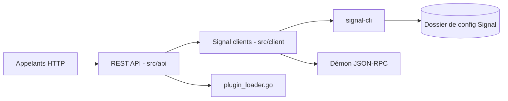

# bbernhard/signal-cli-rest-api

> Dockerized REST API around signal-cli to send and receive Signal messages from scripts.

## The problem
Signal has no simple official API for automating message or notification sending.

## What it actually does
A Go service exposes over HTTP number registration, sending (attachments, groups), receiving, device linking, groups, attachments and profile. It delegates to `signal-cli` in four modes: `normal`, `native` (GraalVM binary), `json-rpc` (JVM daemon) and `json-rpc-native`. Account state (keys) is stored in a mounted folder. A plugin mechanism adds endpoints.

## How it is wired


## Trying it
```bash
mkdir -p $HOME/.local/share/signal-api
sudo docker run -d --name signal-api --restart=always -p 8080:8080 \
      -v $HOME/.local/share/signal-api:/home/.local/share/signal-cli \
      -e 'MODE=native' bbernhard/signal-cli-rest-api
curl -X POST -H "Content-Type: application/json" 'http://localhost:8080/v2/send' \
     -d '{"message": "Test via Signal API!", "number": "+4412345", "recipients": [ "+44987654" ]}'
```

## Cost and gotchas
Free, but you need a Signal number (to register or link via QR code). The mounted folder contains the keys: protect it. `AUTO_RECEIVE_SCHEDULE` can cause message loss if you receive through the API.

## What it is not
It is not an official Signal service. The `native` mode is flagged as potentially less stable. No API authentication is documented.

## Alternatives
No alternative named in the README; `signal-cli` is the underlying building block.

## For you
Worth watching: handy for pipeline alerts to Signal, to be isolated since the API has no documented authentication.
