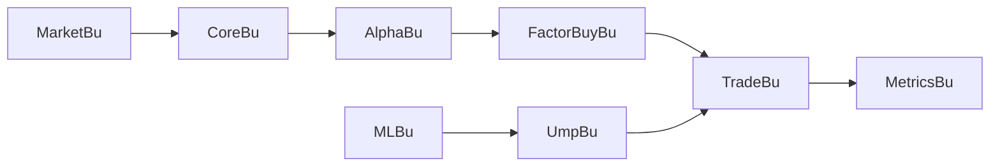

# bbfamily/abu

> Python quantitative trading and backtesting system, documented in Chinese, with an associated web service.

## The problem
Developing, backtesting and optimizing timing and asset selection strategies requires a lot of repetitive code for data, fees, slippage and metrics.

## What it actually does
The `abupy` package provides buy and sell factors, stops, slippage and commissions, position management, stock selection.
Backtest metrics, hyperparameter search by grid search, scoring.
Markets: US, A-share, Hong Kong stocks, futures, options, bitcoin and litecoin; ML module and a "judges" system (UmpBu) to filter trades.
Tutorials in notebooks; a large part of the README promotes the abuquant.com site.

## How it is wired

## Trying it
No shell command: the README recommends Anaconda and only suggests testing `import abupy` in Python.

## Cost and gotchas
Free code under GPL-3.0; real-time AI reports are on a commercial site. Documentation and links essentially in Chinese.

## What it is not
Not a performance guarantee: the "18,496 strategies" and promises of beating the market are not backed up by the README. Not a real trading tool connected to a documented broker.

## Alternatives
No alternative named; the README points to a companion repository abu_ml.

## For you
Ignore: mostly promotional README, unverifiable claims and GPL; for backtesting, better-documented libraries exist in your ecosystem.
