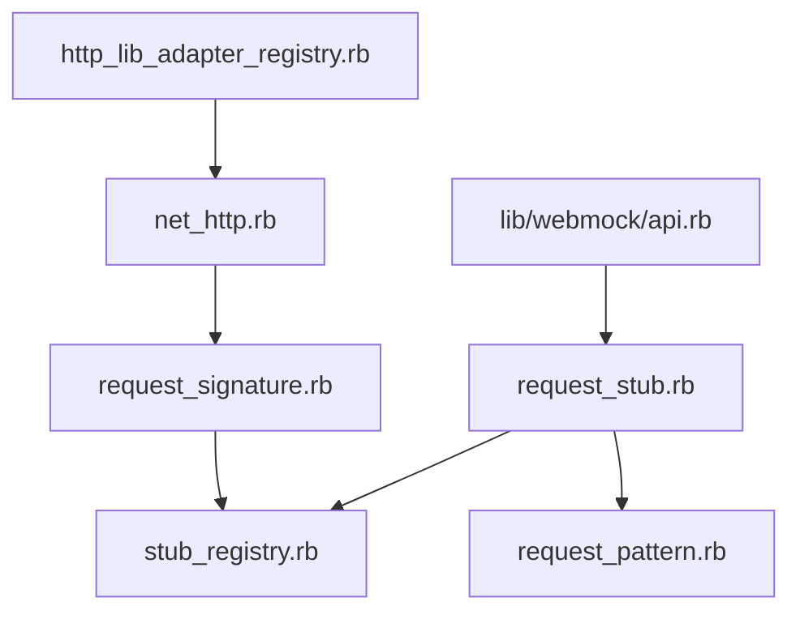

# bblimke/webmock

> Ruby library that simulates HTTP requests and verifies calls in tests.

## The problem
Tests that call real services are slow, fragile and not reproducible.

## What it actually does
WebMock intercepts requests at the HTTP client level (Net::HTTP, Curb, Excon, HTTPClient, httpx, Typhoeus and others). You declare responses with `stub_request` and verify calls with `assert_requested` or RSpec matchers. It compares method, URI, headers and body, accepts regular expressions and RFC 6570 templates, and can block or allow real network access.

## How it is wired


## Trying it
```bash
gem install webmock
```

## Cost and gotchas
Free. It requires Ruby (MRI 2.6 to 4.0 or JRuby). By default, it delays the connection of `Net::HTTP.start`, which changes Net::HTTP behavior. A body declared as a string must match exactly, including for JSON.

## What it is not
It is not a fake server: it replaces the client, and no socket is opened. It does not test the real service.

## Alternatives
No alternative named in the README.

## For you
Ignore: only useful if you test Ruby; in Python you would need an equivalent, not cited here.
