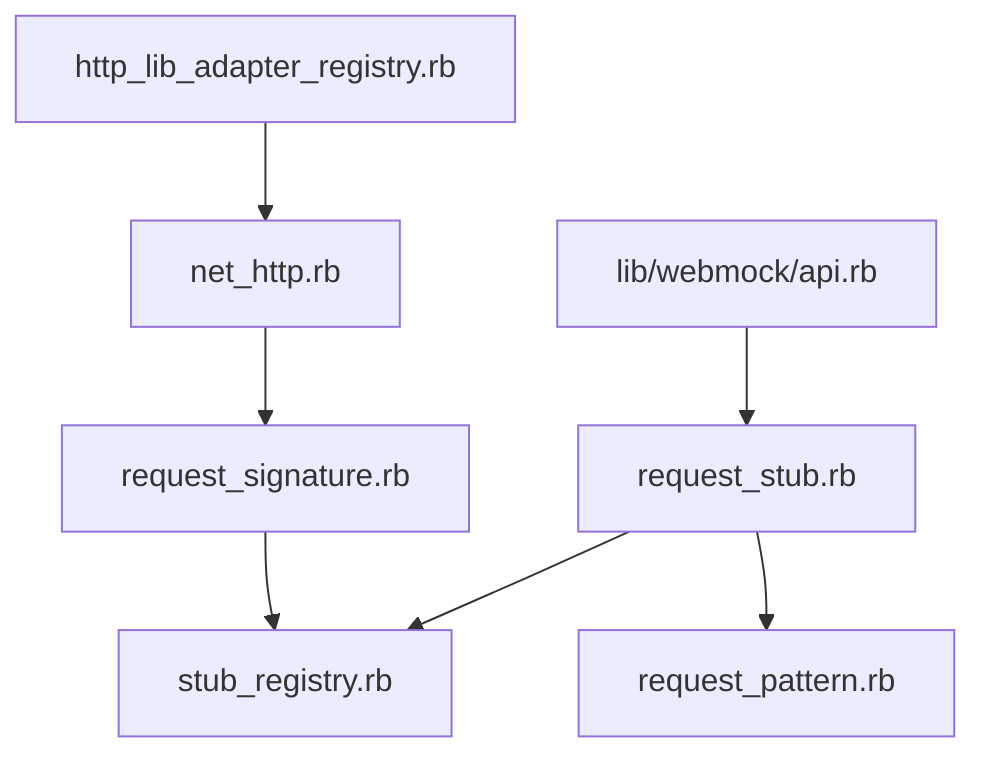

# bblimke/webmock

> Bibliothèque Ruby qui simule les requêtes HTTP et vérifie les appels dans les tests.

## Le problème
Des tests qui appellent de vrais services sont lents, fragiles et non reproductibles.

## Ce que ça fait vraiment
WebMock intercepte les requêtes au niveau des clients HTTP (Net::HTTP, Curb, Excon, HTTPClient, httpx, Typhoeus et autres). On déclare des réponses avec `stub_request` et on vérifie les appels avec `assert_requested` ou des vérificateurs RSpec. Il compare méthode, URI, en-têtes et corps, accepte expressions régulières et modèles RFC 6570, et peut bloquer ou autoriser les accès réseau réels.

## Comment c'est branché


## Essayer
```bash
gem install webmock
```

## Coût et pièges
Gratuit. Il faut Ruby (MRI 2.6 à 4.0 ou JRuby). Par défaut, il retarde la connexion de `Net::HTTP.start`, ce qui change le comportement de Net::HTTP. Un corps déclaré en chaîne doit correspondre exactement, y compris pour du JSON.

## Ce que ce n'est pas
Ce n'est pas un serveur factice : il remplace le client, aucune socket n'est ouverte. Il ne teste pas le service réel.

## Alternatives
Aucune alternative nommée dans le README.

## Pour toi
À ignorer : utile uniquement si tu testes du Ruby ; en Python, il faudrait un équivalent, non cité ici.

