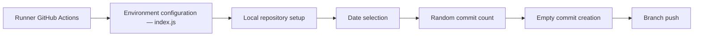

# bcanseco/github-contribution-graph-action

> GitHub Action that creates empty commits to artificially fill your contribution graph.

## The problem
The GitHub contribution graph does not reflect activity done elsewhere (GitLab, Bitbucket, GitHub Enterprise).

## What it actually does
The action reads its environment variables, prepares a clone, picks the eligible dates, draws a random number of commits per day and pushes empty commits. It can fill up to a year back, excluding weekends or weekdays. The README also mentions the benefit of looking good to recruiters.

## How it is wired


## Trying it
```yml
on:
  schedule:
  - cron: '0 12 * * *'
jobs:
  single-commit:
    runs-on: ubuntu-latest
    permissions:
      contents: write
    steps:
    - uses: bcanseco/github-contribution-graph-action@v2
      env:
        GITHUB_TOKEN: ${{ secrets.GITHUB_TOKEN }}
        GIT_EMAIL: you@youremail.com
```

## Cost and gotchas
Free. `FORCE_PUSH=true` wipes the repository on every run. Requires an email associated with the account for the commits to count.

## What it is not
Produces no real work: it fabricates fake activity, which can mislead a recruiter. No value for a data/AI project.

## Alternatives
No alternative named in the README.

## For you
Ignore: it only serves to embellish a contribution graph, which brings you nothing technically and can hurt your credibility.
