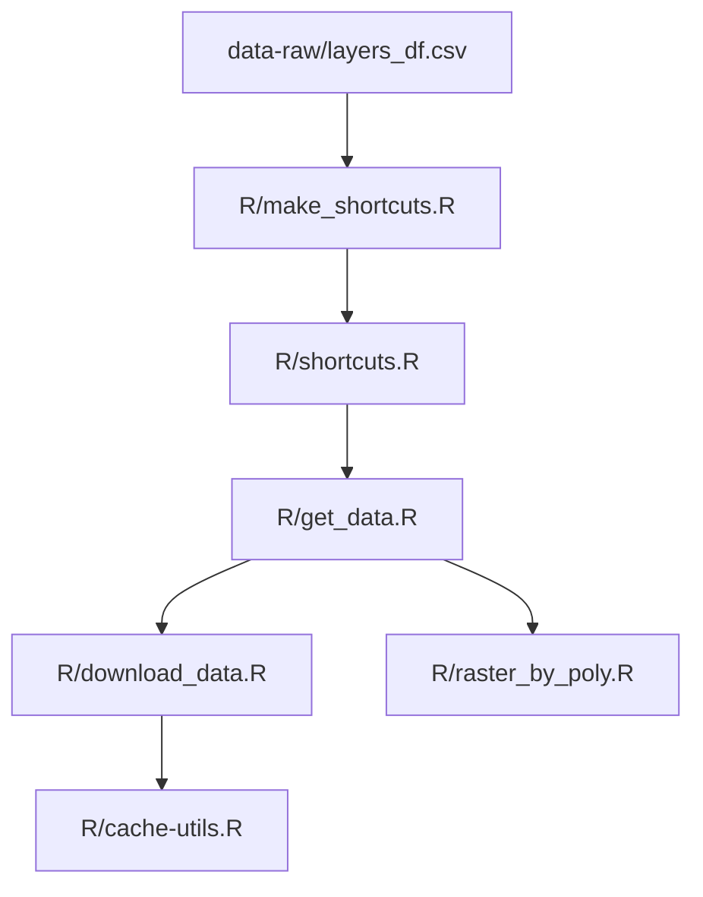

# bcgov/bcmaps

> R package giving access to British Columbia map layers as sf objects.

## The problem
The province's official geographic layers are scattered across an open data catalogue.

## What it actually does
The package exposes layers (administrative boundaries, watercourses, census...) as `sf` objects projected in BC Albers. A `layers_df.csv` file is used to generate shortcut functions that download the data into a local cache, via the bcdata package. Tools also handle rasters and UTM conversions.

## How it is wired


## Trying it
```bash
Rscript -e 'install.packages("bcmaps")'
```
```r
library(bcmaps)
available_layers()
bc <- bc_bound()
```

## Cost and gotchas
Data is downloaded from the B.C. Data Catalogue on first use. Support for `sp` objects was removed in version 1.3.0.

## What it is not
Not a generic mapping tool: it covers British Columbia only.

## Alternatives
No alternative named in the README.

## For you
Ignore: useful only for those working on this Canadian province with R.
