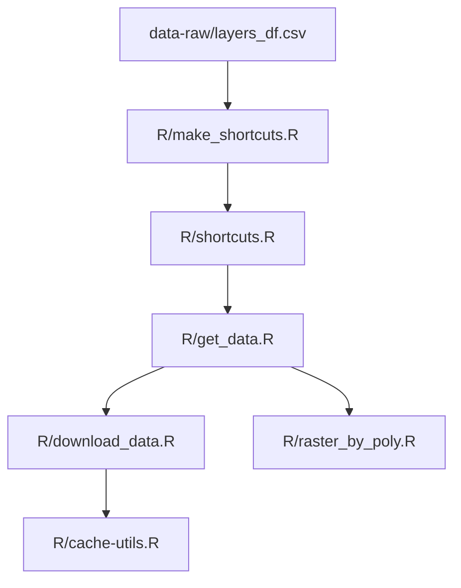

# bcgov/bcmaps

> Paquet R donnant accès aux couches cartographiques de la Colombie-Britannique sous forme d'objets sf.

## Le problème
Les couches géographiques officielles de la province sont dispersées dans un catalogue de données ouvertes.

## Ce que ça fait vraiment
Le paquet expose des couches (limites administratives, cours d'eau, recensement…) en objets `sf` projetés en BC Albers. Un fichier `layers_df.csv` sert à générer des fonctions raccourcis qui téléchargent les données dans un cache local, via le paquet bcdata. Des outils traitent aussi les rasters et les conversions UTM.

## Comment c'est branché


## Essayer
```bash
Rscript -e 'install.packages("bcmaps")'
```
```r
library(bcmaps)
available_layers()
bc <- bc_bound()
```

## Coût et pièges
Les données se téléchargent depuis le B.C. Data Catalogue à la première utilisation. Le support des objets `sp` a été retiré à la version 1.3.0.

## Ce que ce n'est pas
Pas un outil générique de cartographie : il ne couvre que la Colombie-Britannique.

## Alternatives
Aucune alternative nommée dans le README.

## Pour toi
À ignorer : utile seulement pour qui travaille sur cette province canadienne avec R.

