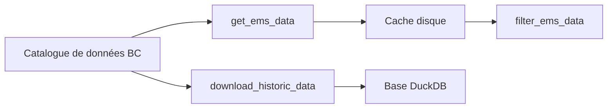

# bcgov/rems

> Deprecated R package for downloading and filtering data from British Columbia's environmental monitoring system.

## The problem
The province's water quality data is large and cumbersome to download, import and filter in R.

## What it actually does
The package downloads results from the British Columbia data catalogue, caches them and filters them (`get_ems_data`, `filter_ems_data`). Historical data since 1964 goes through a DuckDB database queryable with dplyr. It also converts detection limit units.

## How it is wired
Simplified diagram based on the sheet, no diagram provided.



## Trying it
```r
library(devtools)
install_github("bcgov/rems")

library(rems)
two_year <- get_ems_data(which = "2yr", ask = FALSE)
```

## Cost and gotchas
64-bit R is required on Windows. The two-year dataset has over 2 million rows. The data stops on 26 February 2026. The package has not been maintained since March 2026.

## What it is not
Not a living package: it is frozen and replaced by `renmods`, following the new EnMoDs system. It is not on CRAN.

## Alternatives
- renmods: replacement package indicated by the authors.

## For you
Ignore: deprecated R package; if this data interests you, go straight to `renmods`.
