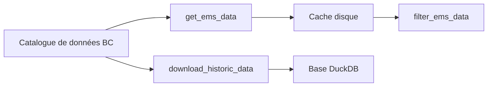

# bcgov/rems

> Package R, déprécié, pour télécharger et filtrer les données du système de surveillance environnementale de Colombie-Britannique.

## Le problème
Les données de qualité de l'eau de la province sont volumineuses et lourdes à télécharger, importer et filtrer sous R.

## Ce que ça fait vraiment
Le package télécharge les résultats du catalogue de données de la Colombie-Britannique, les met en cache et les filtre (`get_ems_data`, `filter_ems_data`). Les données historiques depuis 1964 passent par une base DuckDB interrogeable avec dplyr. Il convertit aussi les unités de seuil de détection.

## Comment c'est branché
Schéma simplifié d'après la fiche, sans diagramme fourni.



## Essayer
```r
library(devtools)
install_github("bcgov/rems")

library(rems)
two_year <- get_ems_data(which = "2yr", ask = FALSE)
```

## Coût et pièges
Il faut R 64 bits sous Windows. Le jeu de deux ans compte plus de 2 millions de lignes. Les données s'arrêtent au 26 février 2026. Le package n'est plus maintenu depuis mars 2026.

## Ce que ce n'est pas
Ce n'est pas un package vivant : il est figé et remplacé par `renmods`, suite au nouveau système EnMoDs. Il n'est pas sur CRAN.

## Alternatives
- renmods : paquet de remplacement indiqué par les auteurs.

## Pour toi
À ignorer : package R déprécié ; si ces données t'intéressent, passe directement à `renmods`.

