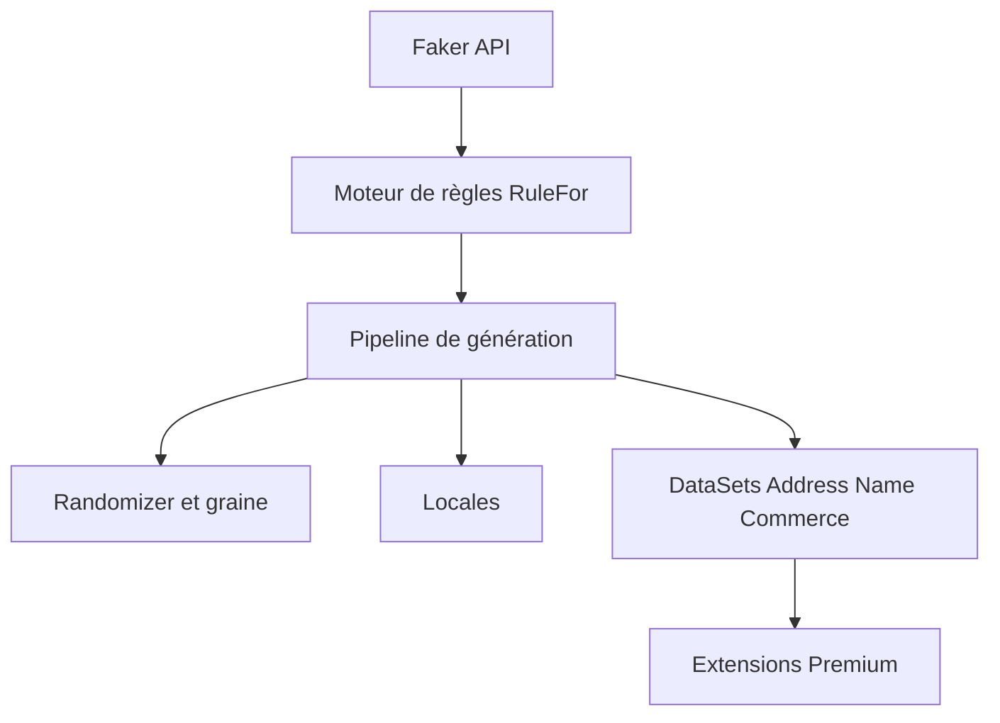

# bchavez/Bogus

> Fake data generator for .NET (C#, F#, VB.NET), to feed tests and databases.

## The problem
Filling a database or interface with realistic data by hand takes time and is not reproducible.

## What it actually does
A fluent `Faker<T>().RuleFor(...)` syntax generates objects with names, addresses, emails, commerce, finance and more than 40 locales. A global or local seed makes datasets deterministic. Extensions provide national identifiers; Premium packages (Locations, Healthcare, Hollywood, Text, Analyzer) are paid.

## How it is wired


## Trying it
```powershell
Install-Package Bogus
```
```csharp
var user = new Faker<User>().RuleFor(u => u.FirstName, f => f.Name.FirstName()).Generate();
```

## Cost and gotchas
Free for the core; advanced datasets are in Premium packages under license. The repository's license is not identified by GitHub.

## What it is not
Not a Python tool nor a generator of statistically faithful synthetic data. The README was truncated when read: the rest was not seen.

## Alternatives
- faker.js (cited): the project Bogus is a port of, on the JavaScript side.

## For you
Keep an eye on it: relevant only in a .NET ecosystem; for data work in Python, it is not the tool.
