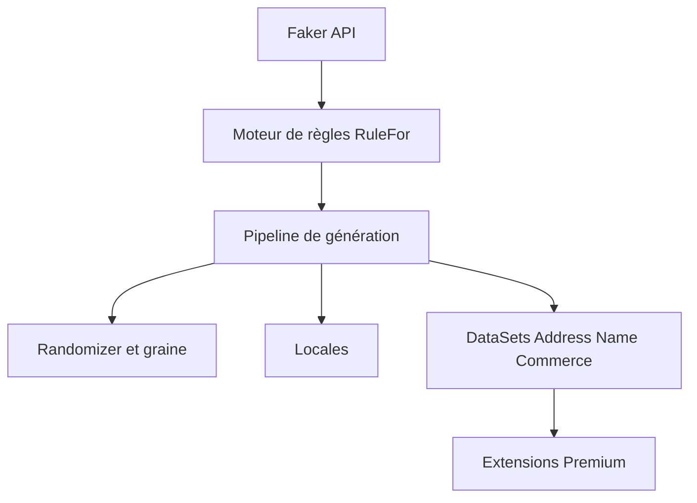

# bchavez/Bogus

> Générateur de fausses données pour .NET (C#, F#, VB.NET), pour alimenter tests et bases.

## Le problème
Remplir une base ou une interface avec des données réalistes à la main prend du temps et n'est pas reproductible.

## Ce que ça fait vraiment
Une syntaxe fluide `Faker<T>().RuleFor(...)` génère des objets avec noms, adresses, e-mails, commerce, finance et plus de 40 locales. Une graine globale ou locale rend les jeux de données déterministes. Des extensions fournissent des identifiants nationaux ; des paquets Premium (Locations, Healthcare, Hollywood, Text, Analyzer) sont payants.

## Comment c'est branché


## Essayer
```powershell
Install-Package Bogus
```
```csharp
var user = new Faker<User>().RuleFor(u => u.FirstName, f => f.Name.FirstName()).Generate();
```

## Coût et pièges
Gratuit pour le cœur ; les jeux de données avancés sont dans des paquets Premium sous licence. La licence du dépôt n'est pas identifiée par GitHub.

## Ce que ce n'est pas
Pas un outil Python ni un générateur de données synthétiques statistiquement fidèles. Le README était tronqué à la lecture : la suite n'a pas été vue.

## Alternatives
- faker.js (cité) : le projet dont Bogus est le portage, côté JavaScript.

## Pour toi
À surveiller : pertinent seulement dans un écosystème .NET ; pour de la data en Python, ce n'est pas l'outil.

