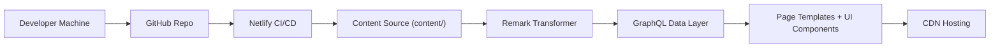

# bchiang7/v4

> Source code of Brittany Chiang's personal website, built with Gatsby and Netlify, forkable as long as she is credited.

## The problem
The repository does not solve a tooling problem: it is a portfolio published as open source. It serves as a design reference, not a reusable building block.

## What it actually does
A static Gatsby site. The Markdown in `content/` (featured, jobs, posts, projects) is read by `gatsby-source-filesystem`, transformed by `gatsby-transformer-remark`, exposed through GraphQL, then rendered by React templates and components. Netlify builds on every push and serves the result from a CDN.

## How it is wired


## Trying it
```bash
npm install -g gatsby-cli
nvm install
yarn
npm start
npm run build
npm run serve
```

## Cost and gotchas
Free. The author did not design the site as a starter theme: no implementation support, she points to the Gatsby docs. Forking requires attribution with a link to brittanychiang.com.

## What it is not
Not a starter or a generic template: the content and design are the author's. Last push in July 2024, with 48 open issues. Nothing to do with data or AI.

## Alternatives
No alternative named in the README (only "previous iterations" of the same site are mentioned).

## For you
Ignore: it is a front-end portfolio unrelated to data, AI or MLOps, and it has not moved since July 2024.
