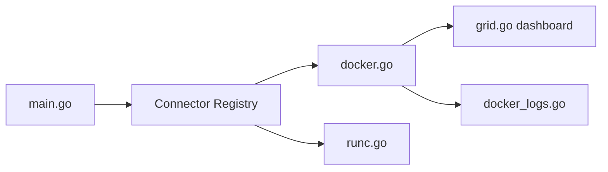

# bcicen/ctop

> Terminal top-like interface for monitoring Docker and runC container metrics.

## The problem
`docker stats` is hard to read as soon as you follow several containers.

## What it actually does
Displays metrics for several containers in real time with sorting, filtering, a detail view, logs, shell exec and column configuration. Docker and runC connectors. A config is saved with `S`.

## How it is wired


## Trying it
```bash
docker run --rm -ti \
  --name=ctop \
  --volume /var/run/docker.sock:/var/run/docker.sock:ro \
  quay.io/vektorlab/ctop:latest
```

## Cost and gotchas
Free. Requires access to the Docker socket. The Debian package is maintained by a third party. Last push in July 2024.

## What it is not
It is not a persistent monitoring tool: no history and no alerts. The other connectors remain "planned".

## Alternatives
- Awesome Docker list: the README points there for similar tools.

## For you
Watch: handy for inspecting a Docker host by hand, but little activity since 2024 and a single maintainer.
