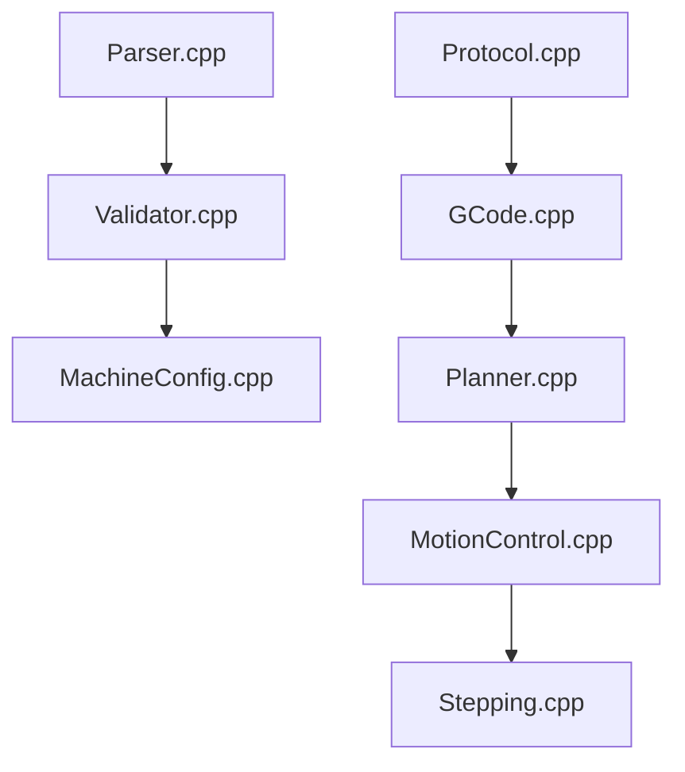

# bdring/FluidNC

> CNC control firmware for the ESP32 microcontroller, Grbl-compatible, configured by file.

## The problem
Driving a CNC or laser machine requires flexible firmware, without recompiling for every machine change.

## What it actually does
The firmware reads a machine configuration file (axes, motors, spindles), accepts Grbl commands, plans motion and drives the step outputs. Built-in web interface, jobs from SD card. AI-assisted configuration tools (JSON schema, validator, MCP server) exist in `tools/`.

## How it is wired

## Trying it
No command in the README; it mentions an installation script and the `$Config/Filename=` command.

## Cost and gotchas
Free. Requires an ESP32 board and a CNC machine. The license needs checking.

## What it is not
Not CAD/CAM software. Not PC software: it is embedded firmware.

## Alternatives
Grbl and Grbl_ESP32, of which FluidNC is the successor.

## For you
Ignore: relevant for digital fabrication, outside the data / AI / MLOps scope.
