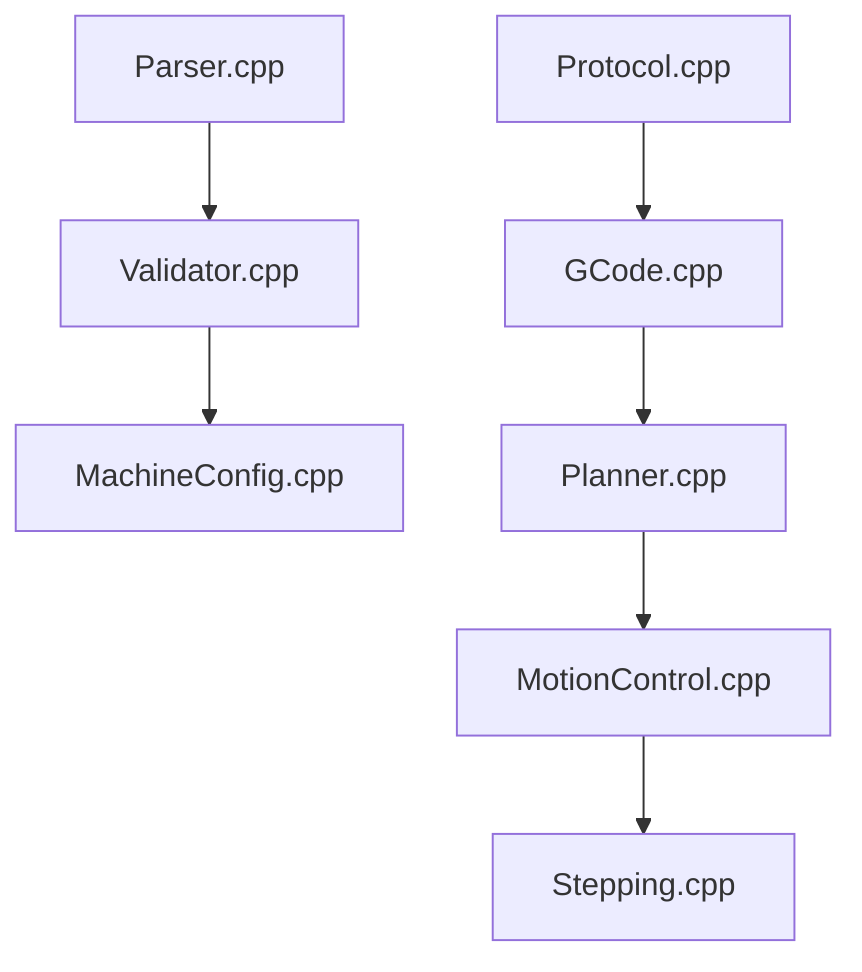

# bdring/FluidNC

> Firmware de commande CNC pour microcontrôleur ESP32, compatible Grbl, configuré par fichier.

## Le problème
Piloter une machine CNC ou laser demande un firmware flexible, sans recompiler à chaque changement de machine.

## Ce que ça fait vraiment
Le firmware lit un fichier de configuration de la machine (axes, moteurs, broches), accepte des commandes Grbl, planifie le mouvement et pilote les sorties de pas. Interface web intégrée, tâches depuis carte SD. Des outils d'aide à la configuration par IA (schéma JSON, validateur, serveur MCP) existent dans `tools/`.

## Comment c'est branché

## Essayer
Aucune commande dans le README ; il mentionne un script d'installation et la commande `$Config/Filename=`.

## Coût et pièges
Gratuit. Exige une carte ESP32 et une machine CNC. La licence est à vérifier.

## Ce que ce n'est pas
Pas un logiciel de CAO/FAO. Pas un logiciel pour PC : c'est un firmware embarqué.

## Alternatives
Grbl et Grbl_ESP32, dont FluidNC est la suite.

## Pour toi
Ignorer : pertinent pour fabrication numérique, hors du périmètre data / IA / MLOps.

