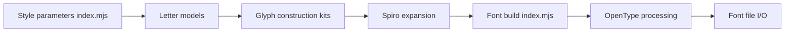

# be5invis/Iosevka

> Customizable monospaced font family, designed for code and terminals.

## The problem
Standard code fonts are wide or barely configurable; it is hard to display many columns without sacrificing readability.

## What it actually does
Provides 6 monospaced subfamilies (sans-serif or slab, 3 spacings) and 2 quasi-proportional ones (Aile, Etoile), in 9 weights, 2 widths, 3 slopes. More than 240 languages, partially covering Latin/Greek/Cyrillic. Character variants, stylistic sets and ligatures can be toggled via OpenType; building from source lets you choose your ligatures.

## How it is wired


## Trying it
```bash
curl -s 'https://api.github.com/repos/be5invis/Iosevka/releases/latest' | jq -r ".assets[] | .browser_download_url" | grep PkgTTC-Iosevka | xargs -n 1 curl -L -O --fail --silent --show-error
brew install --cask font-iosevka
```

## Cost and gotchas
Free (OFL-1.1 license). The repository maintains no package-manager distribution: third-party packages may lag behind. Some software drops OpenType features if the list is too long.

## What it is not
No CJK coverage: the README points to Sarasa Gothic. Not a dev tool, just a font.

## Alternatives
Sarasa Gothic: for Chinese, Japanese and Korean characters.

## For you
Pure editor/terminal comfort: install it if you like dense code, with no stakes for a data pipeline or MLOps.
